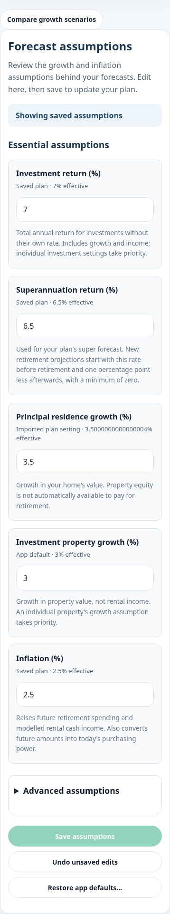
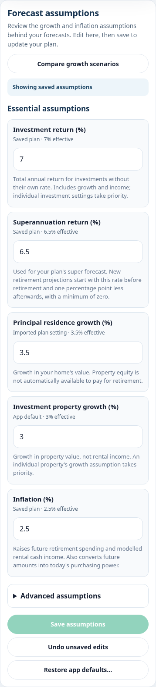
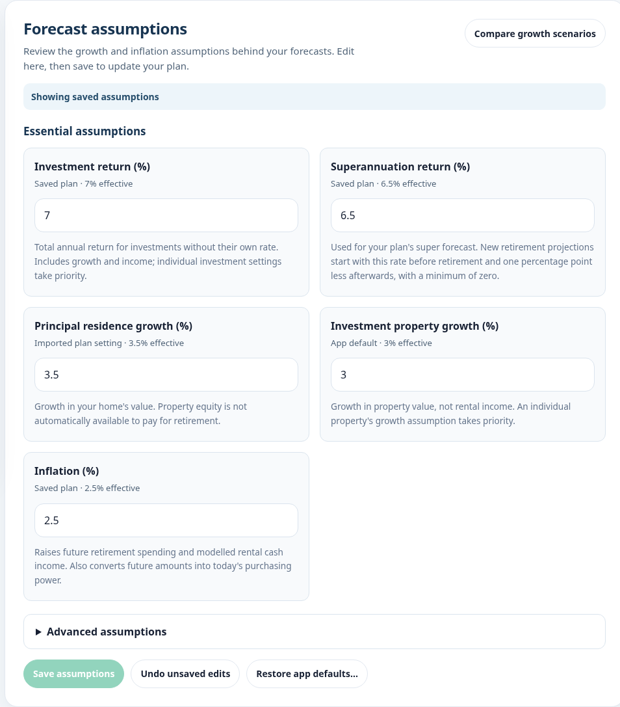

# Forecast Assumptions appearance review

Branch: `ui/forecast-assumptions-mobile`  
Baseline: latest `main` at `a08417d88dfae3d14ab2dc854906cea8df6d3572` (merged PR #58).

## Changes

- The comparison action now belongs to the Forecast Assumptions panel header: aligned beside the introduction on desktop, below it at tablet widths, and full width on phones.
- The heading uses 24px on desktop and 20px on phones. Introductory text uses 15px/14px respectively with a 1.5 line height. Mobile panel/field padding, status notices, section gaps and action spacing are tighter.
- Essential assumptions, collapsed Advanced assumptions, Save, Undo and Restore controls retain their structure and behavior. Inputs/buttons retain at least 44px touch targets; numeric input text remains at the existing readable size.
- Effective-rate labels remove binary floating-point display noise, e.g. `3.5000000000000004%` displays as `3.5%`. This formatting affects only the label, not the rate, input, saved value or calculation.
- The editor reattaches the same comparison DOM when redrawn. This preserves its session edits, event handlers, open state and focus-return target rather than remounting it.

Financial engines, assumption resolution/apply logic, growth overlays, storage/schema, defaults, golden fixtures and dollar conversion are unchanged. App integration changes only where the comparison container is mounted.

## Deployment restriction

The existing repository integration automatically deployed previews for the previous PR. To honor this PR's **do not deploy before review** instruction, `vercel.json` disables Git deployment for exactly `ui/forecast-assumptions-mobile`, using the documented [`git.deploymentEnabled`](https://vercel.com/docs/project-configuration/git-configuration#gitdeploymentenabled) branch map. Other branches retain their existing deployment behavior. No deployment command or hosting mutation is needed.

## Before and after evidence

All screenshots use the same sample fixture, future-dollar basis, closed comparison and collapsed Advanced section. At 390px, the captured workspace height falls from 1,924px to 1,567px (about 19% less scrolling). Baseline screenshots were captured before editing application files. Screenshots include the whole assumptions workspace and bottom actions.

| Width | Before | After |
| --- | --- | --- |
| 375px | [Before](before-375.png) | [After](after-375.png) |
| 390px | [Before](before-390.png) | [After](after-390.png) |
| 430px | [Before](before-430.png) | [After](after-430.png) |
| 768px | [Before](before-768.png) | [After](after-768.png) |
| 1366px | [Before](before-1366.png) | [After](after-1366.png) |

### iPhone-sized layout, 390px

| Before | After |
| --- | --- |
|  |  |

### Desktop, 1366px

## Verification

- `pnpm verify`: **63 suites, 1,247 passed, zero failures/skips**. Includes protected financial hashes, unchanged golden regressions, syntax, inventory, CSP/security, runner and scanner checks.
- `pnpm test:browser`: **50 passed, zero failures/skips**, in 122.5 seconds. All existing browser regressions and the new presentation workflow passed.
- Visual review and before/after captures completed at **375, 390, 430, 768 and 1366px** in Chromium. These are responsive viewport checks; no physical iPhone/Safari run is claimed.
- `git diff --exit-code origin/main` confirms unchanged calculator/retirement engines, assumption adapter, growth overlay/view, schema/storage, sample/default data, dollar conversion and golden fixtures.
- `git diff --check`: passed.

The new browser workflow covers all five requested widths, verifies that the comparison trigger is contained within the panel with no page overflow, opens it with the keyboard, changes Base in memory, redraws the assumptions editor via Undo, and confirms that comparison state and close/focus return survive. It also verifies that plan data and the complete forecast are unchanged, with no runtime/CSP errors. Existing save, advanced-editing, defaults, storage-failure, sample-mode, retirement-snapshot, dollar-basis and growth-scenario browser workflows run unchanged.

The Draft PR must remain unmerged pending review.
