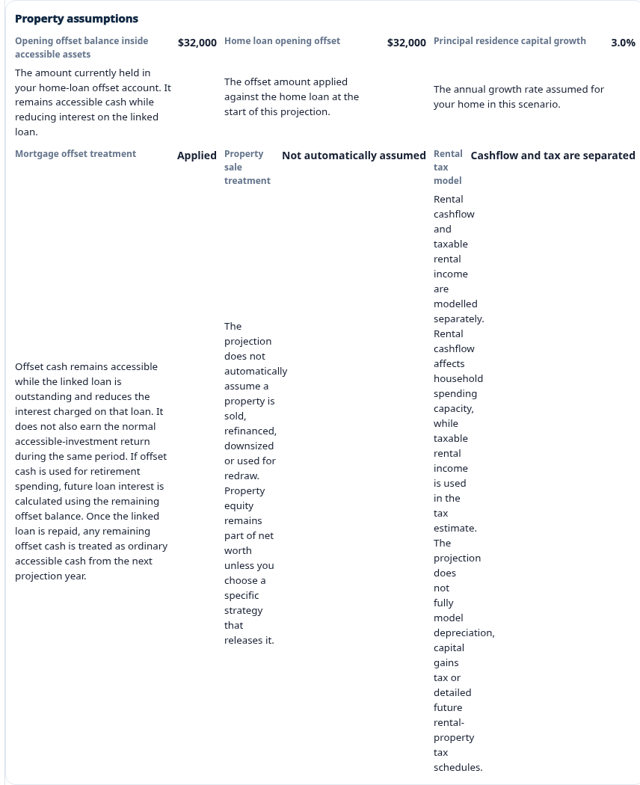
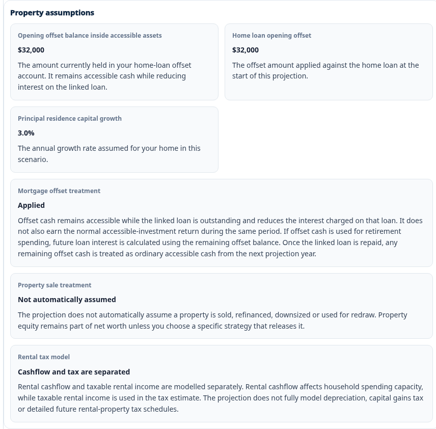

# Investments and retirement assumptions — focused presentation tidy-up

Baseline: latest main `02054bfcf9a687efae6074560104042c0c3a64db`, including merged PR #66. Branch: `ui/assumptions-property-presentation`. Prepared on 16 November 2026 for a separate Draft PR. No merge or deployment; Git deployment is explicitly disabled for this branch.

## Changes and root causes

### 1. Investments assumptions summary

Stage 3 on main already shows one visible Review forecast assumptions action, but leaves four hidden legacy Edit in Assumptions buttons in the DOM. This change removes those duplicate nodes entirely. An idempotent observer handles independent or late form updates as well as the existing render/navigation lifecycle, retaining exactly one action. The action opens the existing central Assumptions workspace; this summary has no second assumptions editor.

The four effective rates use compact cards with equal column widths and aligned value baselines. The annual investing target retains its original input node, value and behavior. Forecast cards and calculations are unchanged.

### 2. Retirement property assumptions

The old outer assumption grid used `repeat(auto-fit, minmax(220px, 1fr))`, often producing three narrow columns on desktop. Each card then inherited a second grid, `minmax(0, 1fr) auto`, designed for short label/value pairs. Long value strings consumed the automatic column and squeezed the label and explanatory note. Grid row sizing also created large empty gaps.

Property and Tax assumptions now receive presentation-only classes in the existing retirement results adapter. Each card groups its original label, value and explanation vertically. The outer grid uses two equal `minmax(0, 1fr)` columns from 1024px and one column below 1024px. Notes longer than 160 characters receive the full grid width on desktop, accommodating mortgage-offset, sale-treatment and rental-tax explanations. This threshold affects layout only.

### 3. Property and rental explanations

Within these scoped groups, cards and text have zero minimum widths, normal white-space and word-breaking, and explicit left alignment. Notes occupy their own full-width row. This removes the inappropriate automatic value column and prevents long explanations from being squeezed into a few characters per line. All original wording, percentages, dollar values, limitations and disclosures remain available. Other financial screens and assumption groups keep their existing layout.

## Verification

- `pnpm verify`: **1,298 tests pass across 67 registered suites**, including inventory, syntax, security, numerical parity, protected-file/function hashes and runner checks.
- Complete `pnpm test:browser`: **75 passed, zero failures** (273 seconds), covering every existing browser suite and the new responsive/content/duplicate-action tests.
- Targeted responsive tests pass at **375, 390, 768, 1024 and 1366px**.
- Every rendered assumption label/value/note is compared with the original retirement renderer, with exact equality.
- Investment tests check all four original label/value pairs, aligned value baselines, annual investing input, unchanged forecast text, exactly one action after three navigation/rerender cycles, and simulated late legacy/duplicate button insertion at every width.
- The surviving action is exercised using pointer input and opens the sole central Assumptions workspace.
- Retirement tests check one/two-column breakpoints, notes at least 200px wide at every requested viewport, separate explanation rows, no clipped notes and no page overflow. Existing browser tests additionally cover saved plans/scenarios, disclosures, keyboard behavior, large values, long names, zero values, negative comparisons and desktop financial workflows.

## Financial safeguards

No changes to `app.js`, calculators, retirement projection functions, financial defaults/assumptions, persistence, schemas, historical results or numerical fixtures. The presentation code moves/removes only editing actions or adds CSS classes to existing rows; it does not calculate financial results.

[Financial parity evidence](financial-parity.json) records byte-identical protected files against main and exact full-output parity across nine fixtures, including retirement and changed retirement scenarios: **zero numerical differences**, with the existing golden fingerprint unchanged. Browser tests separately confirm that the current plan, canonical engine output, retirement result and saved history remain unchanged while visiting the affected screens.

Responsive evidence: [before verification](before-verification.json) and [after verification](after-verification.json).

## Before and after screenshots

There are 20 before and 20 after captures: Investments, Property assumptions, property sale/rental explanations, and the Tax assumptions rental explanation at each requested viewport. Before captures are reproducible from the pinned main source using `FFS_PRESENTATION_PHASE=before`; after captures use this branch. All financial examples use the existing fictional sample plan.

| Area | 375px | 390px | 768px | 1024px | 1366px |
| --- | --- | --- | --- | --- | --- |
| Investments | [Before](before/investments-375.png) / [After](after/investments-375.png) | [Before](before/investments-390.png) / [After](after/investments-390.png) | [Before](before/investments-768.png) / [After](after/investments-768.png) | [Before](before/investments-1024.png) / [After](after/investments-1024.png) | [Before](before/investments-1366.png) / [After](after/investments-1366.png) |
| Property assumptions | [Before](before/property-375.png) / [After](after/property-375.png) | [Before](before/property-390.png) / [After](after/property-390.png) | [Before](before/property-768.png) / [After](after/property-768.png) | [Before](before/property-1024.png) / [After](after/property-1024.png) | [Before](before/property-1366.png) / [After](after/property-1366.png) |
| Sale and rental explanations | [Before](before/explanations-375.png) / [After](after/explanations-375.png) | [Before](before/explanations-390.png) / [After](after/explanations-390.png) | [Before](before/explanations-768.png) / [After](after/explanations-768.png) | [Before](before/explanations-1024.png) / [After](after/explanations-1024.png) | [Before](before/explanations-1366.png) / [After](after/explanations-1366.png) |
| Rental tax explanation | [Before](before/rental-tax-375.png) / [After](after/rental-tax-375.png) | [Before](before/rental-tax-390.png) / [After](after/rental-tax-390.png) | [Before](before/rental-tax-768.png) / [After](after/rental-tax-768.png) | [Before](before/rental-tax-1024.png) / [After](after/rental-tax-1024.png) | [Before](before/rental-tax-1366.png) / [After](after/rental-tax-1366.png) |

### Desktop comparison

| Before | After |
| --- | --- |
|  |  |

## Limitations and readiness

Screenshots and automated interaction checks use Chromium with mobile viewport emulation, rather than physical iPhone/Safari testing. The small scoped layout change is ready for design and device review with local verification green, subject to the GitHub checks on the pushed branch. No unresolved financial dependencies are introduced. Keep the PR Draft; do not merge or deploy as part of this task.

## Welcome-screen follow-up

[Welcome-screen investigation and returning-user evidence](WELCOME-SCREEN-INVESTIGATION.md): no welcome regression reproduced. Original returning-panel screenshots are byte-identical to main at all five widths. The preview uses separate origin storage; first-time, returning, origin-isolation and recovery tests pass. The expanded browser suite now has **78 passing tests**. No application-code change or further deployment was needed.
