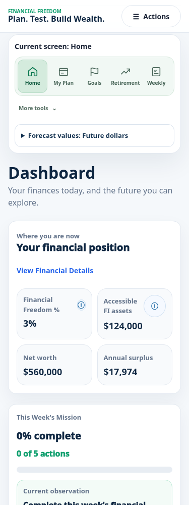
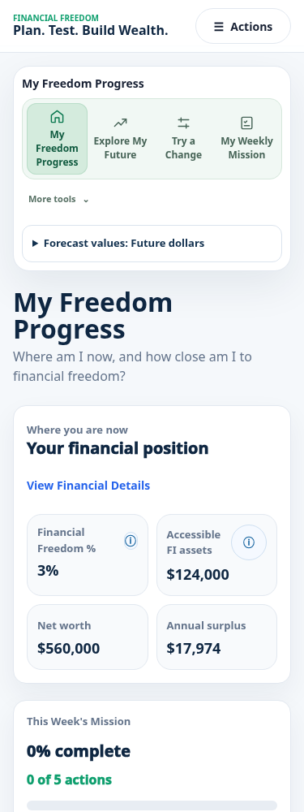

# Four-section navigation redesign — implementation and review report

Branch: `ui/four-section-navigation`. Baseline: latest main `02054bfcf9a687efae6074560104042c0c3a64db`, including merged PRs #64–#66. PR #67 remains unmerged and separate; its unrelated presentation tidy-up is not duplicated in this branch. Draft for user testing only: do not merge or deploy. Git deployment is explicitly disabled for this branch.

## Before and after navigation map

| Before | After | Existing workspace / source |
| --- | --- | --- |
| Home (primary) | **My Freedom Progress** (primary 1) | `dashboard`; original position, FI progress/target, assets/liabilities, milestones and detail views |
| Retirement (primary) | **Explore My Future** (primary 2) | `semiretirement`; original retirement, semi-retirement, scenario inputs, results and annual forecast |
| Growth comparison inside Assumptions | **Explore My Future → Growth scenarios**, also retained in Assumptions | The same mounted growth-workspace node and comparison session, moved between hosts |
| Try a Change (More tools) | **Try a Change** (primary 3) | `decision`; original presets, custom adjustments, baseline and mobile comparisons |
| Weekly (primary) | **My Weekly Mission** (primary 4) | `weeklyplan`; original allocations, creation/editing/saving and history |
| My Plan (primary) | More tools → My Plan | `setup`; original editable wizard, saved step and autosave |
| Goals (primary) | More tools → Goals | `goals`; original goals and optional strategies |
| Assumptions, Investments, Super, Saved Scenarios, Reports | More tools → same destinations | Original IDs and source-of-truth editors preserved |
| Financial Progress history links | Still available from Progress details / Reports | Existing `progress` workspace; `#financial-history` distinguishes it from the main Progress route |
| Promotional AI coaching wording | Neutral Insights entry under More tools | Original Insights handlers, provider disclosures and stored data retained |

The primary order is exactly: **My Freedom Progress → Explore My Future → Try a Change → My Weekly Mission**. Each page uses the requested subtitle verbatim. There is one existing navigation panel; mobile uses four equal-width wrapping buttons, without horizontal primary navigation scrolling. Management tools remain in one labelled disclosure, respecting the existing open/closed preference.

[Pre-implementation architecture assessment](ARCHITECTURE.md) maps rendering, identifiers, save/reload and the single growth mount before implementation.

## Implementation and state behavior

The new presentation adapter wraps the existing navigation/render lifecycle; it does not replace protected financial functions. All original workspace IDs, field IDs, event listeners, saved-data structures and engines remain in place. The single Assumptions editor, single growth comparison, single retirement root and single weekly root are retained. Rebuilding the Assumptions header restores the comparison to the live header, rather than a detached old anchor, without remounting or discarding its session.

Explore My Future has compact Retirement & lifestyle / Growth scenarios controls. The existing projections remain separate. A visible scope explanation identifies Financial Plan growth forecasts versus the dedicated retirement projection and states that outputs are never added together. The existing comparison also explains its saved-assumption baseline, temporary edits and historical snapshot behavior. Existing controls route back to the actual retirement inputs when requested.

First-time visitors see a simple Start My Plan action and Explore a Sample Plan, with explicit fictional-data and household-input guidance. Personal-result previews are hidden until the user deliberately enters a workspace. A stale historical UI flag cannot hide Start when no valid saved draft exists. The existing sample handlers and isolation remain authoritative; sample views carry a visible fictional-sample cue.

Returning base-URL visits with a valid saved draft now enter My Freedom Progress directly, as explicitly requested by this redesign. This intentionally supersedes the old always-open-welcome startup behavior; the original Continue controls remain intact when browser Back returns to welcome. Existing storage-origin boundaries, recovery and backup behavior are preserved. No cloud-saving claim is added.

Browser history uses UI-only state and explicit hashes (`#progress`, `#future`, `#future-growth`, `#change`, `#weekly`, and management-tool hashes). Back/Forward switches the existing workspaces without new financial state. Refresh honors an explicit workspace URL and reloads saved plan/weekly/scenario information. Privacy/terms routes are left to their original handlers. No routing fields are added to financial schemas or storage records.

## Feature-accessibility checklist

| Feature / journey | Access and verification |
| --- | --- |
| New user starts a plan | Welcome → Start My Plan → original editable My Plan wizard; existing blank/partial-plan checks retained |
| Fictional sample exploration | Welcome → Explore a Sample Plan; original sample selection/load/return handlers; no personal draft created just by viewing samples |
| Returning saved plan | Base URL enters My Freedom Progress; saved financial record unchanged by navigation/startup |
| Current position and FI target | Original dashboard cards, financial details, milestones and progress history retained |
| Growth scenarios | Future → Growth scenarios; original Lower/Base/Higher, saved-assumption baseline, overrides, Base parity and dollar basis tests retained |
| Retirement/semi-retirement | Future → Retirement & lifestyle; original timing, lifecycle, spending, pension and funding controls retained |
| Retirement age/spending edits | New journey edits age, validates plan-linked timing, edits temporary spending and checks output against the original projector |
| Detailed annual forecast | Existing annual panels, expanded mobile rows, owner labels, shortfall notes and desktop table retained |
| Try a Change | Primary section; all presets, custom edits, current-versus-adjusted figures, positive/negative and saved baseline tests retained |
| Weekly Mission creation/editing | Original weekly engine and device records; new journey creates a plan, edits recorded income, saves and verifies allocations/history across navigation and refresh |
| My Plan | More tools; original inputs, Next/Previous, saved step and autosave/manual Save behavior retained |
| Assumptions | More tools; one authoritative editor; unsaved edits survive all four primary sections; original save/undo/defaults/validation cases retained |
| Investments / Super / Goals | More tools; original forms/results and central assumptions links; recent mobile disclosures preserved |
| Saved Scenarios | More tools; view/compare/open behavior retained; new journey saves and reopens retirement spending without replacing current-plan inputs |
| Reports and print source | More tools; current-plan executive metrics checked against canonical engine outputs even after opening a retirement snapshot; print invoked; existing scenario comparison/PDF source checks retained |
| Today's / Future dollars | Existing global controls retained in navigation; comparison and retirement formatting remain owned by original components |
| Unsaved navigation state | New tests preserve Assumptions draft and growth comparison edits across all four sections, with the same component nodes |
| Back, Forward and refresh | New browser tests verify hash/state restoration, history length, saved-plan/weekly reload and no financial record replacement |
| Insights and existing stored coaching data | Secondary neutral entry; original functions/provider disclosures remain, without promotional AI coaching in primary presentation |
| Touch/keyboard and overflow | All destinations reachable with pointer input at six widths; primary targets at least 44px; original native keyboard/disclosure tests retained; no page or primary-nav overflow |

## Verification and financial safeguards

- `pnpm verify`: **1,298 passed across 67 registered regression suites**, plus inventory, syntax, security, numerical-parity self-tests, runner checks and protected hash guards.
- `pnpm test:browser`: **78 passed, zero failures** (325 seconds), including all original browser files and the new four-section journeys.
- Responsive evidence and accessibility checks: **375, 390, 430, 768, 1024 and 1366px**.
- New six-width access tests assert every management destination remains reachable, one visible workspace at a time, one editor/comparison/root each, unchanged canonical calculations/current plan/saved scenarios, and no extra retirement projection runs from merely switching destinations.
- Original navigation test expectations were updated only where they explicitly required the superseded five-tab labels/grouping or no-history behavior. Financial assertions, numerical tolerances, golden fixtures and protected-function/file-hash guards were not changed.
- Calculator, super, tax, CGT, pension, retirement funding/withdrawal, property/debt, assumptions/defaults, persistence and schema sources are unchanged. New navigation performs no financial arithmetic and invokes no calculation engine directly.
- Exact complete-output parity over nine baseline/retirement/changed-retirement fixtures: **zero numerical differences**, existing fingerprint `d92aa16abec0034c976fab0552b3423f7ac63fa3cc039cb2e00965c42783833b`.
- The existing Weekly Plan may advance its normal updatedAt metadata during an explicit save/refresh; tests preserve all allocations, actuals and history rather than freezing that timestamp.

[Financial protection evidence](financial-parity.json) · [six-width feature access evidence](access-verification.json).

## Screenshots

Before captures use pinned unchanged main; after captures use this branch. Every example is a bundled fictional/synthetic test plan, not personal user data. Images show first visit and all four main sections at every required width, plus mobile/desktop growth exploration.

| View | 375px | 390px | 430px | 768px | 1024px | 1366px |
| --- | --- | --- | --- | --- | --- | --- |
| welcome | [Before](before/welcome-375.png) / [After](after/welcome-375.png) | [Before](before/welcome-390.png) / [After](after/welcome-390.png) | [Before](before/welcome-430.png) / [After](after/welcome-430.png) | [Before](before/welcome-768.png) / [After](after/welcome-768.png) | [Before](before/welcome-1024.png) / [After](after/welcome-1024.png) | [Before](before/welcome-1366.png) / [After](after/welcome-1366.png) |
| progress | [Before](before/progress-375.png) / [After](after/progress-375.png) | [Before](before/progress-390.png) / [After](after/progress-390.png) | [Before](before/progress-430.png) / [After](after/progress-430.png) | [Before](before/progress-768.png) / [After](after/progress-768.png) | [Before](before/progress-1024.png) / [After](after/progress-1024.png) | [Before](before/progress-1366.png) / [After](after/progress-1366.png) |
| future | [Before](before/future-375.png) / [After](after/future-375.png) | [Before](before/future-390.png) / [After](after/future-390.png) | [Before](before/future-430.png) / [After](after/future-430.png) | [Before](before/future-768.png) / [After](after/future-768.png) | [Before](before/future-1024.png) / [After](after/future-1024.png) | [Before](before/future-1366.png) / [After](after/future-1366.png) |
| change | [Before](before/change-375.png) / [After](after/change-375.png) | [Before](before/change-390.png) / [After](after/change-390.png) | [Before](before/change-430.png) / [After](after/change-430.png) | [Before](before/change-768.png) / [After](after/change-768.png) | [Before](before/change-1024.png) / [After](after/change-1024.png) | [Before](before/change-1366.png) / [After](after/change-1366.png) |
| weekly | [Before](before/weekly-375.png) / [After](after/weekly-375.png) | [Before](before/weekly-390.png) / [After](after/weekly-390.png) | [Before](before/weekly-430.png) / [After](after/weekly-430.png) | [Before](before/weekly-768.png) / [After](after/weekly-768.png) | [Before](before/weekly-1024.png) / [After](after/weekly-1024.png) | [Before](before/weekly-1366.png) / [After](after/weekly-1366.png) |

Growth exploration: [iPhone](after/future-growth-375.png) / [desktop](after/future-growth-1366.png).

| iPhone navigation before | After |
| --- | --- |
|  |  |

## Outstanding concerns and recommendation

No financial-model correction or dependency is introduced. The redesign is intended for **user testing and design review**, not automatic merge or release. Physical iPhone/Safari validation remains recommended: automated checks use Chromium viewport emulation. The full section names wrap on narrow phones; review real-device readability and the new returning-user startup/history behavior with users before approval.

Unsaved comparison/editor drafts remain session-only, as before; navigating preserves them, while a hard refresh restores saved data rather than promising recovery of unsaved edits. PR #67 is separate and unmerged; coordinate its eventual merge normally rather than treating this redesign as approval of its changes.

Keep this PR Draft. Do not merge or deploy as part of this task.
