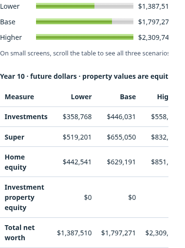
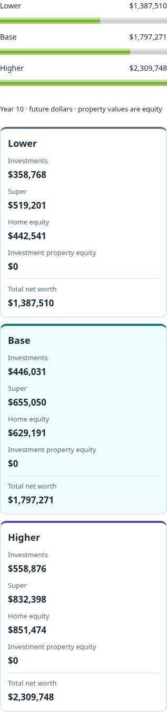

# Mobile growth comparison, More tools and forecast display defaults

Baseline: `25d49e4a033d5af88684842dd6cd9bcdb794207b` (latest main, including merged PR #68). Branch: `ui/mobile-growth-todays-dollars`. Separate Draft PR for review; do not merge or deploy. Git deployment is explicitly disabled for this branch.

## 1. Growth comparison width

On phones and tablets up to 800px, the existing Lower/Base/Higher comparison table is replaced visually by three stacked result cards. Each card identifies its scenario and retains Investments, Super, Home equity, Investment property equity and Total net worth, plus the year and selected dollar-basis information. Labels and values stay in paired rows. Zero values and negative/large dollar figures are retained without clipping.

The result cards and original desktop table are rendered from the **same existing displayed values** and formatter. The presentation layer does not calculate scenario outcomes or apply a second purchasing-power conversion. Only one result presentation is visible at a time, so mobile screen readers do not receive duplicate table/card results.

The old chart reserved fixed/minimum label and amount columns. Mobile chart rows now put the scenario and amount above a full-width meter. The selected-year control, buttons and nested growth containers can shrink to their available width. All three bars and full monetary labels fit. Scroll-sideways hints and the mobile scrolling instruction in the table region label are removed. Desktop retains its original table, chart and data. Growth sections/headings have sticky-header scroll clearance; live interaction tests verify the focused heading remains below the header.

## 2. More tools

At 360–800px, the six requested tools appear in this exact three-column/two-row order:

| Assumptions | Investments | Super |
| --- | --- | --- |
| My Plan | Saved Scenarios | Reports |

All columns are equal, icons are compact and targets are at least 44px. Below 360px the six tools use two columns to preserve readable labels; 320px is additionally tested. Desktop uses two columns.

**Necessary retained destinations:** Goals was already a management tool and Insights preserves underlying functionality. Both remain accessible in a separate row below the six-tool grid, rather than deleting them or adding a seventh tile to the requested two rows. Keyboard order matches the new visual order. The four primary sections, names and workspace IDs are unchanged.

## 3. Today's Dollars defaults and preference preservation

Genuinely new users and newly created blank personal plans start in **Today's Dollars**. Display conversion still uses the existing inflation/purchasing-power functions. The interface states explicitly that this is display-only and calculations and saved amounts remain nominal.

Existing explicit Today/Future choices remain valid. The old browser preference key, `ffs.ui.forecastDollarBasis`, is read compatibly and is written only after an explicit dollar-control selection. Creating a new plan does **not** overwrite that key or the previous plan's display preference.

A separate UI-only preference map (`ffs.ui.forecastDollarBasisPlans.v1`) associates display choices/defaults with existing plan ID and stable creation metadata (`meta.updatedAt`, which the existing identity function retains). It adds no fields to a financial plan, scenario, schema or backup and does not change identifiers or timestamps. It lets a new plan retain its Today default on refresh while the earlier plan keeps its Future choice, even when the browser-wide legacy key still says Future.

- Existing saved plan with a legacy explicit choice: retain it and remember it for that plan.
- New blank plan, including after confirmed New Plan/Clear: default Today, without rewriting the previous preference.
- Cancelled New Plan: keep the current plan and display choice.
- Refresh: restore the active saved plan's UI choice/default.
- Sample plans: inherit the current display basis. An explicit selection remains a display choice across the sample and active personal context; sample data never replace personal inputs. Returning from a sample to a genuinely new personal plan defaults that new plan to Today.
- Saved scenarios/snapshots: inherit the current display basis and retain their own original inputs, inflation rules and nominal historical results. Opening a scenario is not treated as creating a new personal plan.
- Blocked storage: display switching remains usable in memory, with the same financial-save/recovery behavior as before.

## Verification

- `pnpm verify`: **1,305 tests across 68 suites passed**, with zero failures. Inventory, syntax, browser security, test-runner self-checks, secret checks and protected-function guards passed.
- `pnpm test:browser`: **82 tests passed**, zero failures/skips, in 392 seconds. All existing browser suites were included.
- Exact numerical parity: **9 fixtures, zero numerical differences**; protected files and numerical golden fixtures unchanged.

- Required widths: **375, 390, 430, 768, 1024 and 1366px**. Additional narrow-screen fallback: **320px**.
- New browser tests compare every mobile label/value pair against the original desktop table, and each bar value against Total net worth, for both Today and Future Dollars, standard and large-negative outcomes, at every required width.
- Visible mobile component bounds and page width are checked for clipping/overflow. Desktop table visibility and hidden mobile cards are checked separately.
- Tool tests verify exact six-tool order, three equal columns, two-column fallback, touch targets, all original destinations and unchanged four-section navigation.
- Preference tests cover new users, old global choices, new-plan creation/cancellation, scoped default persistence, samples, saved retirement snapshots, refresh and unchanged nominal plan/results/history.
- Seven new isolated preference regression cases also cover both legacy values, older-plan retention, corrupt UI settings, blocked storage and read-only identity extraction.
- Existing chart, Future You, retirement, pension, comparison, report/PDF, saved scenario, financial-source and complete-backup browser checks remain in the full suite. The nominal pension-caption test now explicitly selects Future Dollars rather than assuming the previous default; its assertions and financial figures are unchanged.

[Comparison parity across widths/bases](comparison-parity.json) · [protected-file and financial parity evidence](financial-parity.json).

## Financial safeguards

No investment/super, tax/CGT/pension, property/debt, inflation, retirement funding or withdrawal formulas changed. No financial defaults/assumptions, saved financial schemas, protected financial functions or numerical golden fixtures changed. The new preference controller handles UI enum values only. Its lifecycle adapters select a display basis before existing renderers run and leave original plan creation/recovery logic intact.

Exact complete-output parity across nine calculation/retirement/changed-retirement fixtures: **zero numerical differences**. Existing golden fingerprint: `d92aa16abec0034c976fab0552b3423f7ac63fa3cc039cb2e00965c42783833b`. Nominal calculation and archived data stay identical; amounts shown in today's purchasing power intentionally differ from their future-dollar display according to the existing conversion rules.

## Before and after screenshots

There are 12 before and 12 after component screenshots: growth results/chart and More tools/display default, at all six widths. Before captures use pinned unchanged main. Growth captures explicitly select Future Dollars on both versions so the monetary values can be compared directly; the separate tools/default captures show the changed initial selection. Examples are the existing fictional sample plan.

Component captures temporarily make the unrelated site header static to prevent Chromium's beyond-viewport crop from painting it across the image. Live header/focus geometry is checked separately under normal sticky positioning.

| Area | 375px | 390px | 430px | 768px | 1024px | 1366px |
| --- | --- | --- | --- | --- | --- | --- |
| growth-results | [Before](before/growth-results-375.png) / [After](after/growth-results-375.png) | [Before](before/growth-results-390.png) / [After](after/growth-results-390.png) | [Before](before/growth-results-430.png) / [After](after/growth-results-430.png) | [Before](before/growth-results-768.png) / [After](after/growth-results-768.png) | [Before](before/growth-results-1024.png) / [After](after/growth-results-1024.png) | [Before](before/growth-results-1366.png) / [After](after/growth-results-1366.png) |
| tools-and-default | [Before](before/tools-and-default-375.png) / [After](after/tools-and-default-375.png) | [Before](before/tools-and-default-390.png) / [After](after/tools-and-default-390.png) | [Before](before/tools-and-default-430.png) / [After](after/tools-and-default-430.png) | [Before](before/tools-and-default-768.png) / [After](after/tools-and-default-768.png) | [Before](before/tools-and-default-1024.png) / [After](after/tools-and-default-1024.png) | [Before](before/tools-and-default-1366.png) / [After](after/tools-and-default-1366.png) |

| iPhone growth results — before | After |
| --- | --- |
|  |  |

## Readiness and limitations

Local verification is green and the changes are ready for final review, subject to GitHub checks. Automated responsive checks use Chromium; physical iPhone/Safari review remains recommended. UI preferences remain browser-local and are not a cloud-sync or financial-backup schema. No known financial-model dependency is introduced.

Keep Draft. Do not merge or deploy as part of this task.
