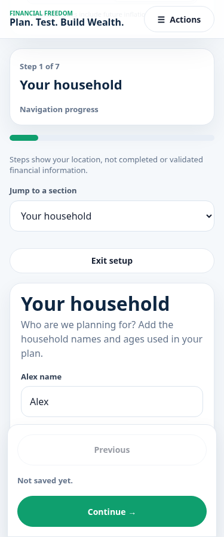
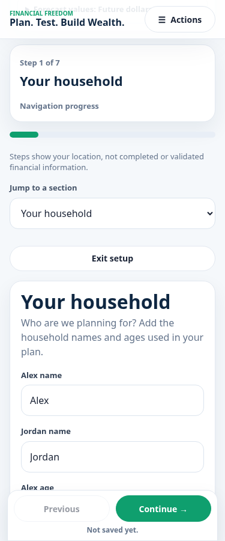
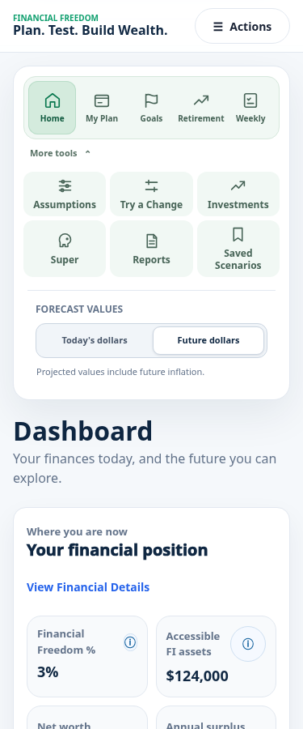
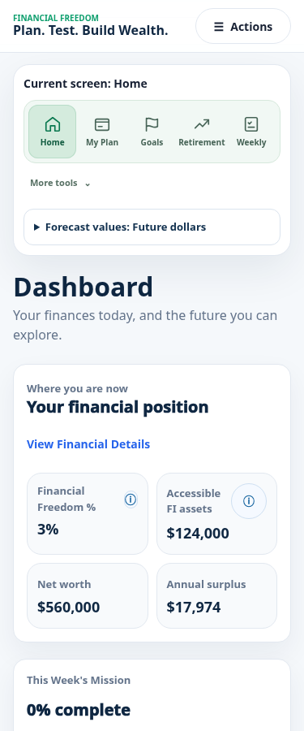
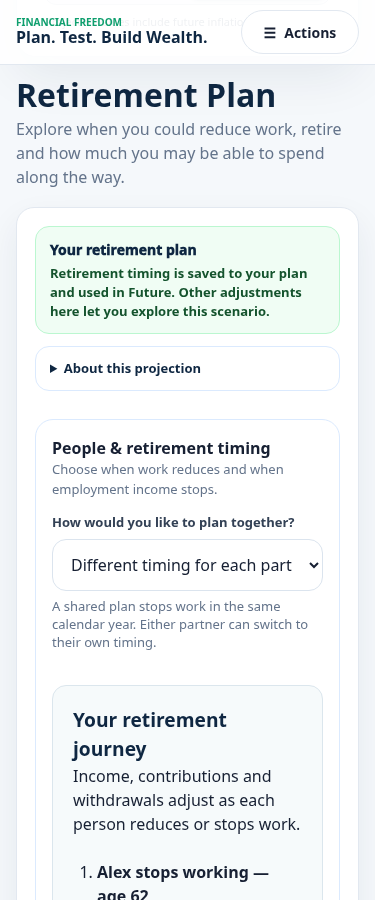
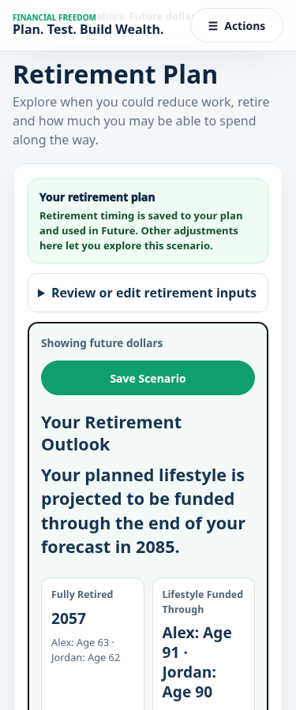

# Stage 3 mobile usability — U06–U10

Baseline: `bfb708361120a227db4e871cebfe22a9ed8c2809` (main after Stage 2 / PR #65). Roadmap PR #64 was merged on 14 November 2026. Branch: `ui/mobile-usability-stage3`. This change is for review in a separate Draft PR; no merge or deployment is requested or performed. Git deployments are disabled for this branch.

## Corrections

| Finding | Implemented behavior |
| --- | --- |
| U06 — setup footer | Previous and Continue share one row, with the full save status below. Buttons retain 44px minimum targets. Content padding follows the measured footer height; focused fields have scroll clearance. A keyboard-sized VisualViewport reduction releases the sticky footer. |
| U07 — first visit | Start My Plan is the primary entry, followed by its next step. The existing sample selector and load actions are secondary and explicitly describe fictional examples; on mobile they sit inside one disclosure. Repeated mobile setup shortcuts are removed from the landing layout. Saved-plan Continue and the sample/personal return behavior remain intact. |
| U08 — navigation | All five primary tabs and every More tools destination remain. Fresh iPhone visits start with More tools collapsed; an explicit stored preference is respected. The current screen is identified above the tabs. The dollar-basis summary names the selected basis and opens the original controls. Scroll clearance keeps the navigation below the header. |
| U09 — Investments | Four repeated assumptions edit buttons become one Review forecast assumptions action. Existing effective rates remain in a compact grid and still link to the authoritative Assumptions workspace. The annual investing input remains editable. Existing forecasts appear first on mobile. |
| U10 — Goals, Super, Retirement | Goals shows existing FI outcomes before editing. Super shows the engine's current balance, forecast checkpoints and a contextual contribution action; employer and tax detail are disclosed. Retirement puts one review/edit disclosure above the existing outlook; detailed controls are grouped inside it. Timing edits, temporary adjustments and saved-scenario drafts have explicit scope labels. Edit Scenario and Manage expenses reveal their target groups before the original focus handlers run. Optional goals and downsizing are disclosed. |

## Architecture assessment and safeguards

Navigation uses the existing `showWorkspace` / `setView` flow and delegated `data-view` controls, rather than a URL router. Forms and retirement results are rebuilt by existing renderers; those renderers and the financial model are guarded by regression hashes. The Stage 3 adapter wraps their lifecycle and moves the original DOM nodes, retaining IDs, input values and listeners. Disclosure state is captured before re-renders, retained while navigating the same plan, and reset when the plan identity changes. It is UI-only state and adds nothing to saved-plan schemas. Mobile disclosure wrappers are removed when changing to desktop, preserving the original desktop form structure.

The adapter reads the existing Super result and uses the existing money formatter. It performs no financial arithmetic or projection recalculation. No investment, super, tax, CGT, pension, retirement funding, withdrawal, assumption/default, persistence/schema or historical-result code is changed. Golden fixtures and protected hashes are unchanged.

[Financial safeguard evidence](financial-safeguards.json) records byte-for-byte checks against main and exact complete-output parity across nine fixtures, including baseline and earlier-retirement scenarios: **zero numerical differences**. Browser parity checks cover every affected workspace at all five widths: [before](before-parity.json), [after](after-parity.json).

## Verification

- `pnpm verify`: 67 registered regression suites, 1,298 tests, zero failures. Includes inventory, syntax, browser security, numerical parity, runner failure propagation, secret scan and existing protected-function/file-hash checks.
- Complete `pnpm test:browser`: **73 passed, zero failures**, including all regression browser files (254 seconds). The final touch-target check also passes.
- Responsive browser checks: **375, 390, 430, 768 and 1366px**. iPhone layouts receive the compact disclosures; tablet and desktop retain the full editing layout.
- New browser coverage checks footer size and lower-field focus, simulated keyboard release/restoration, native keyboard disclosures, input retention across navigation and re-render, saved-history isolation, one assumptions action, dollar controls and More tools persistence, original desktop controls after resizing, canonical engine parity and page overflow.
- Existing browser coverage retains long household names, large dollar amounts, zero values, negative comparisons, saved scenarios, Base growth parity, plan persistence and all five main destinations. The household journey uses real pointer input. Its helper follows the new native disclosures and waits for scroll anchoring to settle without bypassing hit testing or removing assertions.

## Screenshots

All examples are the existing fictional sample plans or the app's blank first visit. Each before image comes from the pinned unchanged main sources, served by the same local browser harness. After images use this branch. Captures include both outcomes and editing controls.

| Screen at 375px | Before | After |
| --- | --- | --- |
| U06 My Plan | [Before](before/u06-my-plan-375.png) | [After](after/u06-my-plan-375.png) |
| U07 first visit | [Before](before/u07-home-375.png) | [After](after/u07-home-375.png) |
| U08 navigation | [Before](before/u08-navigation-375.png) | [After](after/u08-navigation-375.png) |
| U09 investment results | [Before](before/u09-investments-375.png) | [After](after/u09-investments-375.png) |
| U09 assumptions controls | [Before](before/u09-assumptions-375.png) | [After](after/u09-assumptions-375.png) |
| U10 Goals | [Before](before/u10-goals-375.png) | [After](after/u10-goals-375.png) |
| U10 Super | [Before](before/u10-super-375.png) | [After](after/u10-super-375.png) |
| U10 Retirement outcome | [Before](before/u10-retirement-375.png) | [After](after/u10-retirement-375.png) |
| U10 Retirement editing | [Before](before/u10-retirement-editing-375.png) | [After](after/u10-retirement-editing-375.png) |

### Mobile comparison gallery

| Screen | Before | After |
| --- | --- | --- |
| My Plan footer |  |  |
| Navigation |  |  |
| Retirement |  |  |

### All responsive captures

| Screen | 390px | 430px | 768px | 1366px |
| --- | --- | --- | --- | --- |
| u06-my-plan | [Before](before/u06-my-plan-390.png) / [After](after/u06-my-plan-390.png) | [Before](before/u06-my-plan-430.png) / [After](after/u06-my-plan-430.png) | [Before](before/u06-my-plan-768.png) / [After](after/u06-my-plan-768.png) | [Before](before/u06-my-plan-1366.png) / [After](after/u06-my-plan-1366.png) |
| u07-home | [Before](before/u07-home-390.png) / [After](after/u07-home-390.png) | [Before](before/u07-home-430.png) / [After](after/u07-home-430.png) | [Before](before/u07-home-768.png) / [After](after/u07-home-768.png) | [Before](before/u07-home-1366.png) / [After](after/u07-home-1366.png) |
| u08-navigation | [Before](before/u08-navigation-390.png) / [After](after/u08-navigation-390.png) | [Before](before/u08-navigation-430.png) / [After](after/u08-navigation-430.png) | [Before](before/u08-navigation-768.png) / [After](after/u08-navigation-768.png) | [Before](before/u08-navigation-1366.png) / [After](after/u08-navigation-1366.png) |
| u09-investments | [Before](before/u09-investments-390.png) / [After](after/u09-investments-390.png) | [Before](before/u09-investments-430.png) / [After](after/u09-investments-430.png) | [Before](before/u09-investments-768.png) / [After](after/u09-investments-768.png) | [Before](before/u09-investments-1366.png) / [After](after/u09-investments-1366.png) |
| u09-assumptions | [Before](before/u09-assumptions-390.png) / [After](after/u09-assumptions-390.png) | [Before](before/u09-assumptions-430.png) / [After](after/u09-assumptions-430.png) | [Before](before/u09-assumptions-768.png) / [After](after/u09-assumptions-768.png) | [Before](before/u09-assumptions-1366.png) / [After](after/u09-assumptions-1366.png) |
| u10-goals | [Before](before/u10-goals-390.png) / [After](after/u10-goals-390.png) | [Before](before/u10-goals-430.png) / [After](after/u10-goals-430.png) | [Before](before/u10-goals-768.png) / [After](after/u10-goals-768.png) | [Before](before/u10-goals-1366.png) / [After](after/u10-goals-1366.png) |
| u10-super | [Before](before/u10-super-390.png) / [After](after/u10-super-390.png) | [Before](before/u10-super-430.png) / [After](after/u10-super-430.png) | [Before](before/u10-super-768.png) / [After](after/u10-super-768.png) | [Before](before/u10-super-1366.png) / [After](after/u10-super-1366.png) |
| u10-retirement | [Before](before/u10-retirement-390.png) / [After](after/u10-retirement-390.png) | [Before](before/u10-retirement-430.png) / [After](after/u10-retirement-430.png) | [Before](before/u10-retirement-768.png) / [After](after/u10-retirement-768.png) | [Before](before/u10-retirement-1366.png) / [After](after/u10-retirement-1366.png) |
| u10-retirement-editing | [Before](before/u10-retirement-editing-390.png) / [After](after/u10-retirement-editing-390.png) | [Before](before/u10-retirement-editing-430.png) / [After](after/u10-retirement-editing-430.png) | [Before](before/u10-retirement-editing-768.png) / [After](after/u10-retirement-editing-768.png) | [Before](before/u10-retirement-editing-1366.png) / [After](after/u10-retirement-editing-1366.png) |

## Limitations and readiness

The automated browser is Chromium, with touch-sized viewport emulation. The software-keyboard test simulates VisualViewport shrinkage; this is not a physical iPhone or Safari keyboard test. Review on a physical iPhone, especially lower-field focus with its keyboard open, remains recommended before approval.

No known unresolved U06–U10 failures remain in the tested browser flows. U11–U14 remain outside this PR. The changes are suitable for final design and device review, subject to passing GitHub CI. Keep the PR Draft; do not merge or deploy as part of this stage.
