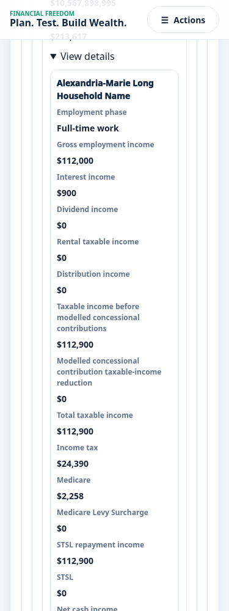
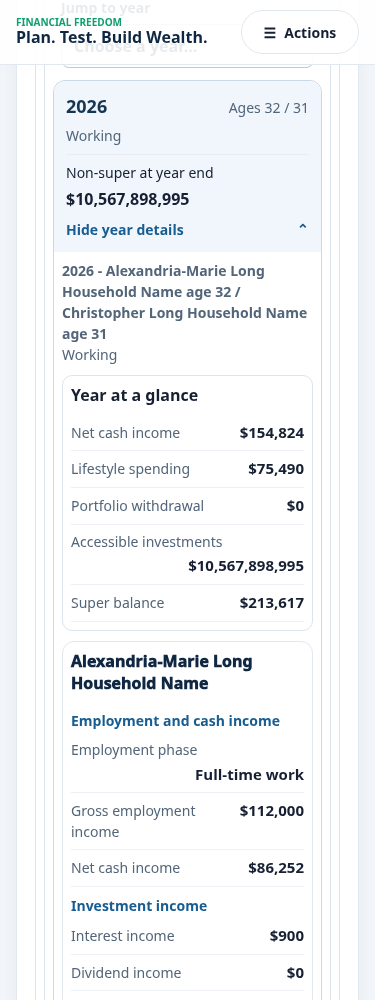
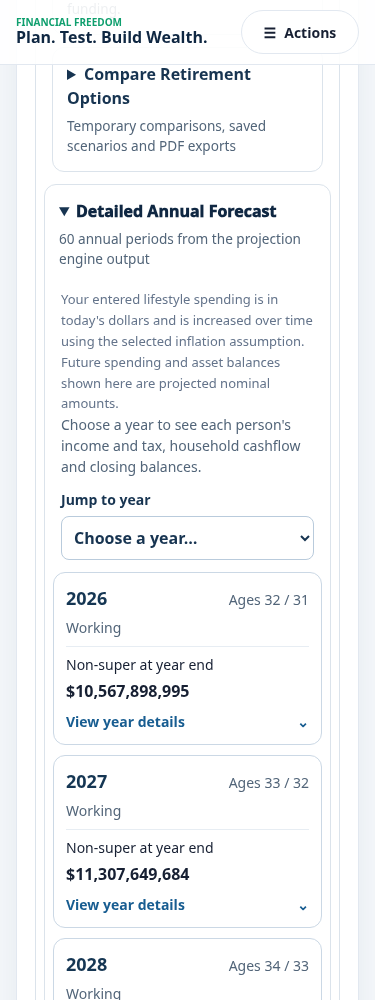

# Annual forecast mobile improvement and journey review

Read the [prioritised usability report](REPORT.md). Wider recommendations are for review; only the annual forecast is redesigned.

## Before and after

Screenshots use identical synthetic couple inputs and stress-test names/balances. Baseline is main `913700cda5599d459c26cf821d2fa1da4124e3fa`.

| Width | Before expanded | After expanded | After year summaries |
|---|---|---|---|
| iPhone 375px |  |  |  |
| iPhone 390px | [Before](before/annual-expanded-390.png) | [After](after/annual-expanded-390.png) | [Summaries](after/annual-collapsed-390.png) |
| Tablet 768px | [Before](before/annual-expanded-768.png) | [After](after/annual-expanded-768.png) | [Summaries](after/annual-collapsed-768.png) |
| Desktop 1366px | [Before](before/annual-expanded-1366.png) | [Original desktop table retained](after/annual-expanded-1366.png) | [Collapsed](after/annual-collapsed-1366.png) |

Additional evidence: [single-person shortfall](after/annual-shortfall-375.png), [phone navigation](journey/375-navigation.png), [first visit](journey/375-first-visit.png), [blank setup](journey/375-my-plan-empty.png), [saved comparison](journey/375-scenario-compare.png), [report](journey/375-reports.png).

## Implementation and preservation

`retirement-results.js` moves existing annual detail nodes into native year disclosures and groups original person rows. `styles.css` scopes cards to screen widths up to 900px and retains the desktop/print table. It adds no financial arithmetic, changes no formatted amount, and does not write saved data. Existing disclosure state handles expansion; no saved-data schema is introduced.

Automated checks preserve all source rows and person ownership by year, the desktop table text, projection results, current plan and saved scenarios. Tests include header-aware navigation, Enter/pointer controls, long names and $9.8bn balances. Numerical fixtures and protected hashes are not updated.

## Reproduction

Use Node 24 and the repository's pnpm version; install Chromium or set `FFS_BROWSER_EXECUTABLE`.

```sh
pnpm verify
pnpm test:browser
pnpm test:browser-mobile
# Intentionally refresh the selected published evidence:
FFS_CAPTURE_MOBILE_EVIDENCE=1 pnpm test:browser-mobile
# Reproduce baseline annual images using the pinned main presentation files:
FFS_CAPTURE_MOBILE_EVIDENCE=1 FFS_MOBILE_BEFORE=1 node --test --test-name-pattern='mobile annual forecast readable' tests/dollar-basis-browser.mjs
```

Normal runs write new mobile captures to ignored `test-results/mobile-usability/`. The capture opt-in publishes selected images here; unselected screen captures stay ignored. `journey-evidence.json` retains observations for all 84 screen states; a null `screenshot` means its image is reproducible locally rather than committed. The before/after annual JSON records nested-table visibility and clipping, rather than relying on page width alone.

The historical repository browser suites also regenerate their existing evidence; discard unrelated regenerated evidence before committing this scoped change. This PR is Draft and disables automatic Vercel deployments for its branch. Physical iPhone Safari/VoiceOver and real-household validation remain recommended before release.
