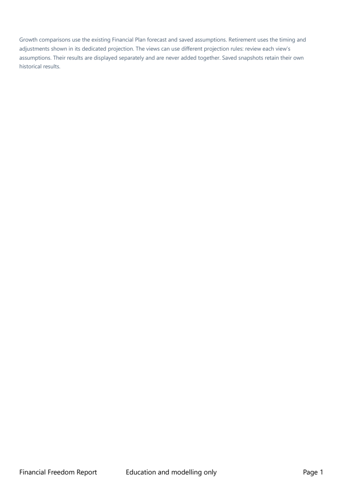
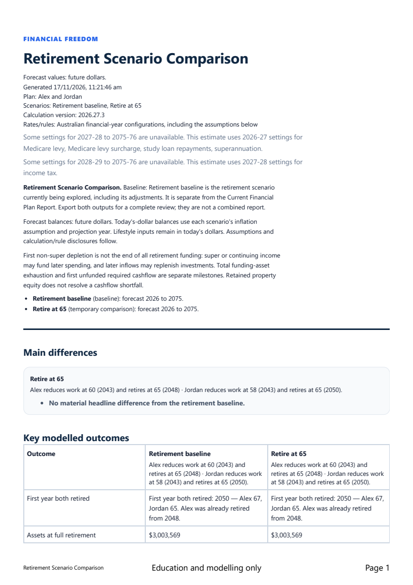
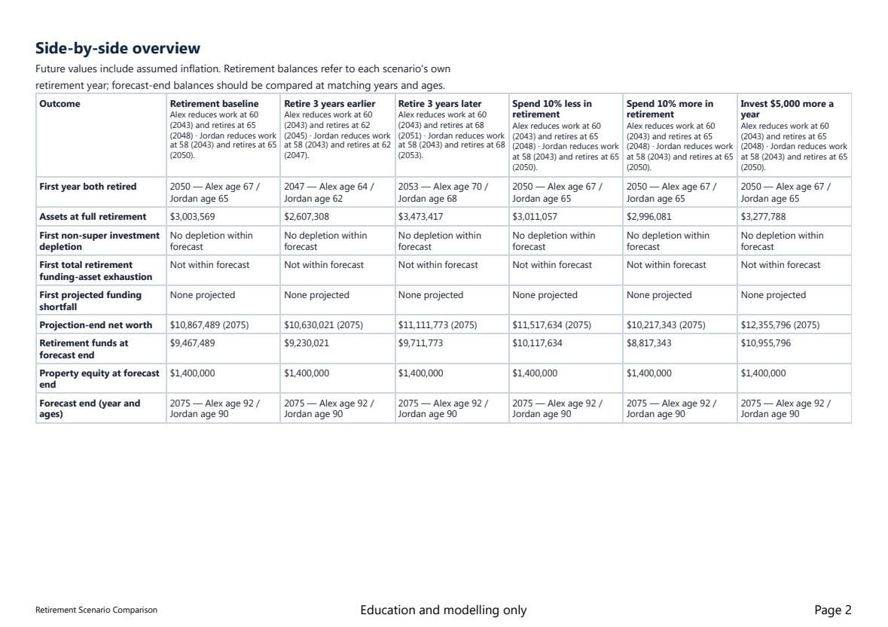

# Reporting scope and retirement comparison presentation

Reviewed from latest main at task start: `a22a862f64a96df3e0d1416d2df72e1f18c1fff2`.
Branch: `fix/reporting-retirement-presentation`. No merge or deployment.

## Confirmed issues and corrections

1. The retirement panel is inside `#appWorkspace`. The existing print override changed the section to block but left its **child desktop grid** active. At a 1440px print-emulation viewport the report occupied only 240-250px. The child now uses block layout, no grid tracks/gap, and full width. Report ancestors lose screen-only maximum widths, borders and padding only when printing. The unrelated `.freedom-model-note` caused a mostly empty first page; it is hidden along with the future-mode controls and growth host. The duplicate app-wide disclaimer is also hidden; the report retains its full disclosures, avoiding a disclaimer-only last page. The report now opens with its title and scope. Wide reports have an intentional cover followed by the overview; heading/subtitle protections, repeated table headers and fixed table layout keep columns readable. The current-plan executive section can flow after the expanded scope without becoming an empty cover page.
2. Current-plan reporting did not adopt retirement results, but its title and the comparison's `Current Plan` baseline could suggest that it did. The product title remains **Financial Freedom Report**, with **Current Financial Plan Report**, horizon, dollar basis and separate-export guidance. Retirement comparisons identify **Retirement baseline**, or the opened saved scenario's name. Each output retains generated date, assumptions, calculation version and carried-forward rule disclosures. No combined pack is implied.
3. `Accessible investments last until` described only the first non-super depletion event. Comparison labels now distinguish that event from total retirement funding-asset exhaustion, first funding shortfall, funding through the selected horizon and remaining funding assets/property equity. They consume `view.longevity` and canonical closing-year balances; no depletion calculation was added. Copy explains continuing super/income, later replenishment and why property equity cannot resolve a cashflow shortfall. End-net-worth comparisons do not show a numerical delta across different forecast end years.
4. Scenario subtitles omitted work reduction and showed only retirement ages. Shared screen/print subtitles now show each person's elected semi-retirement and full-retirement age, with calendar years taken from that person's canonical annual rows when available. Already-retired flags and missing legacy values have explicit wording; no missing age/date is inferred.
5. The comparison contribution note repeated inclusion of extra concessional events. The presentation adapter removes the second inclusion statement and retains eligibility/contribution-limit guidance.

## Architecture and integrity

The app is a plain browser application. `calculator.js` and `semiRetirementProjection.js` supply calculations, `semiRetirementUi.js` supplies canonical view models, `app.js` supplies renderers and existing dollar-basis adapters, and `styles.css` handles printing. No applicable AGENTS.md was found in the checkout or ancestor directories.

`installReportingPresentation` follows the app's existing renderer-adapter pattern, installed after its dollar-basis adapters. Original audited functions and their exact hash guards remain intact. The adapter copies summaries for display and reads the existing dollar converter with each scenario's own inflation/start year. The opened scenario name is transient presentation state. Historical snapshots and stored results are never rewritten by this patch.

No financial engines, defaults (including the 3% wage-growth fallback), schemas, storage, saved scenario calculations, growth comparisons, numerical goldens or protected guard expectations changed. `vercel.json` adds only this branch to the existing deployment-disabled map, preventing an automatic preview deployment when the review branch is pushed.

## Validation

- `pnpm run verify`: passed; **69 suites, 1,310 tests**, no failures/skips. Includes inventory, syntax, browser-security policy, parity self-tests, runner self-tests, secret scanning and numerical/protected-function guards.
- Final focused run: **33 tests passed**, including the new reporting suite, unchanged protected-function test and existing multi-scenario presentation tests.
- Real Edge/Chromium browser PDF generation: two-scenario side-by-side, two-scenario portrait, six-scenario landscape in both dollar bases, full six-scenario landscape and six-scenario portrait. Current-plan reports were generated in both bases after opening a differently named saved retirement snapshot.
- Browser assertions check displayed comparison summaries against canonical retirement/end-year values with the correct scenario inflation and year. Saved/current comparisons, saved baseline names, current-plan canonical result invariance, saved snapshot serialization invariance and actual 375px/1440px navigation clicks after printing pass.
- Five focused regressions cover canonical non-super depletion with continued super funding, genuine shortfall despite retained property equity, later replenishment, inflation-adjusted end balances, complete/legacy pathways, report scope and single contribution-inclusion wording.
- Deep equality of complete inputs and canonical results passes for **22 before/after scenario instances** across five export cases. See [validation.json](reporting-evidence/validation.json).
- Every generated PDF was rasterized for visual review; all final PDFs have zero text characters outside page bounds. Representative full-size pages and the original broken opening are included. PDF inspection summaries record page sizes/counts. HTML checks or `window.print()` alone were not used as evidence.

## Representative before/after PDFs

All fixtures are fictional. Alex/Jordan here come from the repository's report fixture with explicit work-reduction ages 60/58 and retirement ages 65/65; they are **not** the user's unavailable slide input snapshots.

| Output | Before | After | Pages before / after |
| --- | --- | --- | --- |
| Two scenarios, side-by-side, future dollars | [PDF](reporting-evidence/before/two-future.pdf) | [PDF](reporting-evidence/after/two-future.pdf) | 9 / 9 |
| Two scenarios, portrait, today's dollars | [PDF](reporting-evidence/before/two-today.pdf) | [PDF](reporting-evidence/after/two-today.pdf) | 9 / 8 |
| Six scenarios, landscape overview, future dollars | [PDF](reporting-evidence/before/wide-future.pdf) | [PDF](reporting-evidence/after/wide-future.pdf) | 5 / 5 |
| Six scenarios, landscape overview, today's dollars | [PDF](reporting-evidence/before/wide-today.pdf) | [PDF](reporting-evidence/after/wide-today.pdf) | 6 / 5 |
| Six scenarios, full landscape | [PDF](reporting-evidence/before/wide-full.pdf) | [PDF](reporting-evidence/after/wide-full.pdf) | 22 / 26 |
| Current plan after opening saved retirement scenario, future dollars | [PDF](reporting-evidence/before/current-plan-future.pdf) | [PDF](reporting-evidence/after/current-plan-future.pdf) | 12 / 13 |
| Current plan after opening saved retirement scenario, today's dollars | [PDF](reporting-evidence/before/current-plan-today.pdf) | [PDF](reporting-evidence/after/current-plan-today.pdf) | 15 / 16 |
| Six-scenario portrait | Not captured | [PDF](reporting-evidence/after/portrait-six.pdf) | - / 21 |

The full report is intentionally longer because distinct funding/end-balance details are included and scenario cards stay together. The wide overview uses 9pt tables; regular comparison tables use 9.5pt. Portrait scenarios stack rather than squeezing six columns onto portrait paper. Screen geometry evidence is 240-250px before versus the full 1440px container after; actual A4 PDFs use approximately 186mm portrait / 273mm landscape printable widths.





## Reproduction and limits

Set `FFS_PLAYWRIGHT_MODULE` to an installed Playwright `index.mjs`; the browser harness uses installed Microsoft Edge. Run from the checkout:

```text
node scripts/verify-reporting-scope.mjs test-results/reporting-before --baseline
node scripts/verify-reporting-scope.mjs test-results/reporting-after
python scripts/inspect-reporting-pdfs.py test-results/reporting-after
```

`FFS_REPORT_BASE_REF` optionally overrides the recorded baseline SHA. Python inspection requires `pypdfium2`, `pdfplumber` and Pillow. Browser-only hooks are inserted by the local test server, not shipped in production. Full scenario JSON is written locally for numerical auditing; only compact validation evidence and fictional PDFs are committed.

Edge/Chromium output was inspected; physical printers, Safari and Firefox print engines were not tested. Existing saved-scenario opening/comparison behavior recalculates a review from stored inputs without modifying historical results; that behavior is unchanged. No new calculation defect was established in this review, and no claim is made about the unavailable historical Alex/Jordan totals. Production remains unchanged.
