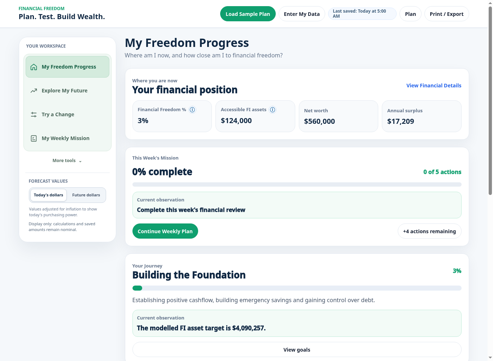
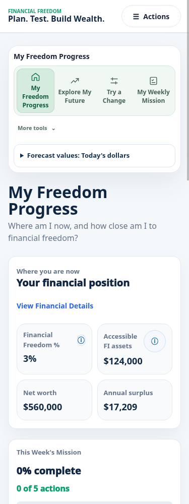
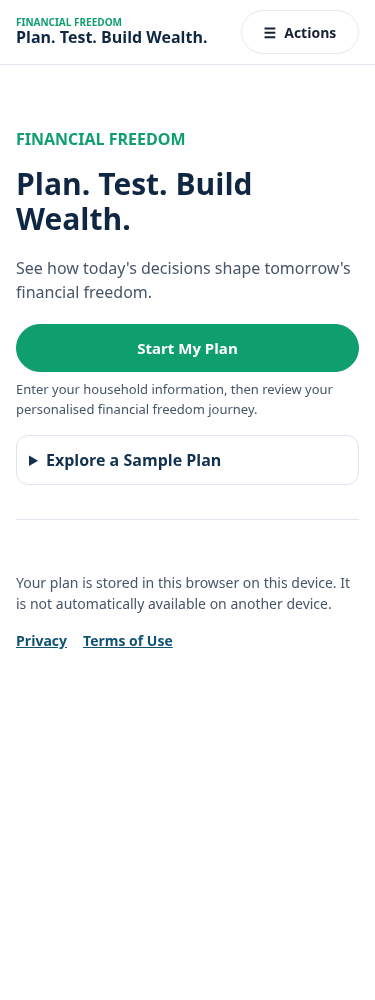

# Returning dashboard and desktop header

## Scope and baseline

A separate Draft PR from latest main `b98955029638f675541e0b5bd34f3c6c77aaeeab` (merged PR #69). No merge or deployment is part of this work. Git deployment is explicitly disabled for `ui/returning-dashboard-header`.

## Investigation and changes

### Returning users

Main already directs a valid saved personal plan at the ordinary app URL to **My Freedom Progress**, without a Continue click. This PR preserves that route and the existing dashboard instead of building another dashboard. Explicit workspace links and browser Back/Forward remain supported; refreshing an explicit section URL still opens that section. A bare app URL defaults to My Freedom Progress even if the saved UI last used Investments or another tool.

Startup previously required both a successfully loaded `savedDraft` and a second `hasSavedDraft()` storage read. If the first load succeeded but later reads became unavailable, the app had the user's plan in memory but classified the visitor as new and showed the welcome screen. Startup now uses the plan already validated and restored by `loadDraft()`. No recovery/persistence functions or their validators are changed.

The welcome section also starts hidden until the existing navigation initializer classifies the visitor. This prevents the first-time welcome from flashing while application scripts load for a returning user. A browser test deliberately pauses the app script to verify the pre-startup screen, then verifies welcome for a new visitor and dashboard for a returning household after release.

The regression reproduces this interrupted-read case against pinned unchanged main: **welcome despite a loaded saved household**. With the fix: **My Freedom Progress using that same saved household**, with stored bytes unchanged. Normal returning users still reach the same original dashboard in both versions. The screenshots do not imply this was a universal failure on main.

### First-time visitors and recovery

No saved plan means the existing welcome remains, with its start-plan and sample-plan actions. Sample data are never loaded automatically. Existing wording and the four primary section labels/IDs are unchanged.

Existing recovery behavior is preserved:

- Legacy personal plans follow the original migration and open directly.
- A partially entered saved plan opens its dashboard, retaining the original incomplete-results guidance.
- A corrupt namespaced copy can use a valid legacy copy while preserving the corrupt bytes and showing the existing recovery notice.
- When neither copy is valid, show welcome plus the existing Import backup / Start new plan recovery actions; do not replace either copy.
- When storage is unavailable from the first read, show welcome and the existing storage/recovery notice. Do not invent a personal dashboard or silently load a sample.
- When a valid plan has already loaded and later reads fail, show its dashboard; existing storage warnings remain available.

Saved plans remain local to the browser and origin. A different preview domain, device or browser can correctly show first-visit welcome because it cannot read another origin's storage. Importing a complete backup remains the existing explicit recovery path; this PR does not transfer or overwrite storage automatically.

### Desktop header

Removed the duplicate `lastSavedLabel` element beneath the Financial Freedom logo/tagline. Retained the original `headerSaveStatus` indicator, its live region and the existing save-update code. The old updater already tolerates the removed element being absent, so none of its protected logic needs modification.

Desktop has one header save-status indicator. It still shows transient saving/status messages and then the latest saved time. The wizard's local save feedback remains unchanged. Mobile retains its original compact logo/Actions header (the desktop toolbar and its status pill were already hidden there). No controls are duplicated or moved.

## Verification

- `pnpm verify`: **1,305 tests across 68 suites passed**, zero failures/skips. Inventory, syntax, enforcing browser security, runner, secret checks and protected-function guards passed.
- `pnpm test:browser`: **87 passed**, zero failures/skips, in 389 seconds. This includes all existing browser suites and the five new cases.
- Required desktop/mobile coverage expanded to **375, 390, 430, 768, 1024 and 1366px**.
- Five new browser tests cover first visit/returning startup, recovery, interrupted storage reads header timestamp/action behavior and the delayed-script first paint.
- At every width, returned dashboard `innerHTML` exactly matches the existing dashboard generated before reload, including its cards, values and chart markup. The underlying complete calculation result and saved personal record are unchanged.
- Timestamp testing starts with a known old date, saves an actual input edit, waits for the existing transient messages to finish and checks that the remaining indicator reflects the new save. Desktop Plan and mobile Actions/Plan controls are checked using pointer input. Existing backup prompts are dismissed before hit-target checks.
- Existing browser coverage retains deep links, history, all four sections, assumptions, saved scenarios, retirement, comparisons, charts, reports/PDF and backups.
- Exact numerical parity: **9 complete-output fixtures, zero differences**. Golden SHA256: `d92aa16abec0034c976fab0552b3423f7ac63fa3cc039cb2e00965c42783833b`.
- **17 protected source files and all 777 protected app functions are unchanged.** No financial formulas, assumptions, projection rules, financial schemas or numerical fixtures changed.

[Financial safeguards](financial-safeguards.json) · [opening checks at six widths](after/opening-verification.json).

## Screenshots

Screenshots use a fictional test household saved as a personal plan in an isolated local browser profile. They contain no real user's finances. Both sets use the same saved fixture; before comes from pinned unchanged main. Full-viewport captures retain the real sticky header and existing dashboard layout.

| Opening screen | 375px phone | 390px phone | 430px phone | 768px tablet | 1024px desktop | 1366px desktop |
| --- | --- | --- | --- | --- | --- | --- |
| first-visit | [Before](before/first-visit-375.png) / [After](after/first-visit-375.png) | [Before](before/first-visit-390.png) / [After](after/first-visit-390.png) | [Before](before/first-visit-430.png) / [After](after/first-visit-430.png) | [Before](before/first-visit-768.png) / [After](after/first-visit-768.png) | [Before](before/first-visit-1024.png) / [After](after/first-visit-1024.png) | [Before](before/first-visit-1366.png) / [After](after/first-visit-1366.png) |
| returning-dashboard | [Before](before/returning-dashboard-375.png) / [After](after/returning-dashboard-375.png) | [Before](before/returning-dashboard-390.png) / [After](after/returning-dashboard-390.png) | [Before](before/returning-dashboard-430.png) / [After](after/returning-dashboard-430.png) | [Before](before/returning-dashboard-768.png) / [After](after/returning-dashboard-768.png) | [Before](before/returning-dashboard-1024.png) / [After](after/returning-dashboard-1024.png) | [Before](before/returning-dashboard-1366.png) / [After](after/returning-dashboard-1366.png) |

| Case | Phone | Desktop |
| --- | --- | --- |
| Interrupted storage after a valid load | [Before](before/interrupted-storage-375.png) / [After](after/interrupted-storage-375.png) | [Before](before/interrupted-storage-1366.png) / [After](after/interrupted-storage-1366.png) |
| Invalid saved data recovery | [After](after/recovery-375.png) | [After](after/recovery-1366.png) |

### Updated desktop opening

### Updated phone opening

### First-time phone welcome

## Limitations and readiness

Automated browser checks use Chromium. Physical iPhone/Safari verification remains recommended. This change cannot make one origin read another origin's local storage. No financial-model dependency or new saved-data schema is introduced.

Local regression and complete browser verification are green. Ready for review subject to GitHub checks. Keep Draft; do not merge or deploy without further approval.
