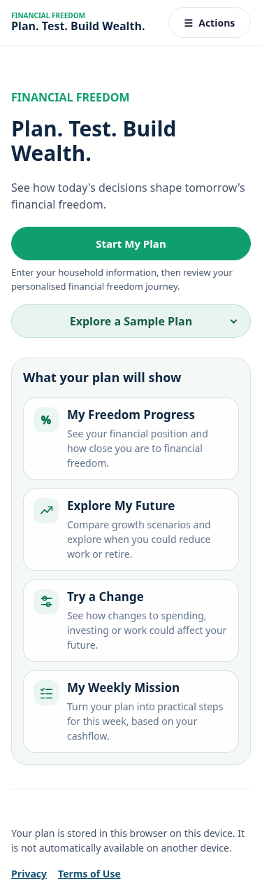
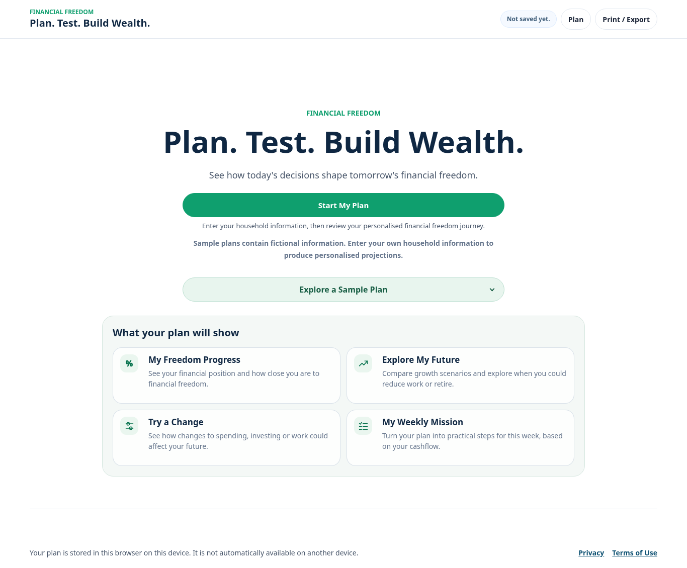

# Welcome sample button and feature cards

Baseline: latest main `244adcf695d6a44b000f2f63ba389d9051d3043e` (merged PR #70). Separate Draft PR, branch `ui/welcome-sample-feature-cards`. Do not merge or deploy as part of this change.

## Presentation

- **Explore a Sample Plan** is a light-green pill with centred text, matching the width and minimum height of **Start My Plan**. The small chevron points down when closed and up when expanded.
- Uses the existing native `details`/`summary` controls: keyboard Enter/Space, focus indication and touch interaction remain available. Selecting/opening a fictional example still requires the existing explicit action.
- Four descriptive cards sit immediately below the sample control: **My Freedom Progress**, **Explore My Future**, **Try a Change** and **My Weekly Mission**. These mirror the app’s current four primary sections.
- Reuses the existing placeholder-card and green icon styles from the reference design. Cards stack on phones and use two columns above 600px.
- Between 521–760px the existing mobile selector and load button stay visible inside the sample disclosure, avoiding a second nested sample dropdown. Desktop retains the existing sample menu and destinations, with the matching light-green trigger.
- Returning users still open directly to their saved dashboard. Welcome cards remain part of the hidden welcome screen and do not duplicate during rerenders/navigation.

## Safeguards and verification

Production changes are **HTML and scoped CSS only**. No application JavaScript, financial calculations, assumptions, projection rules, saved-plan schemas or numerical fixtures changed. All 17 protected source files, `app.js` and the navigation/display modules remain byte-identical to main.

- `pnpm verify`: **1,305 tests across 68 suites passed**, zero failures, including syntax, security, inventory, runner checks, protected-function guards and nine exact complete-output parity fixtures (**zero numerical differences**).
- Targeted Chromium browser run: **4 tests passed**, zero failures. Covers sample menu keyboard/pointer actions, new/returning startup and pre-startup welcome suppression, with new responsive/card checks.
- Widths checked: **320, 375, 390, 430, 600, 768, 1024 and 1366px**. No page overflow or clipped card content. Touch targets are at least 44px (sample trigger 48px).
- Expanding the menu leaves the plan unchanged and does not load or save sample data. Explicit sample selection still works. Start My Plan still opens setup; returning saved plans still open My Freedom Progress.
- Complete seven-before/seven-after screenshot evidence below uses pinned unchanged main as the baseline.

The complete browser suite was not rerun for this scoped HTML/CSS change; the targeted command and evidence are recorded in [verification.json](verification.json) and [responsive-verification.json](responsive-verification.json). Screenshots and browser checks use Chromium; physical iPhone/Safari review remains recommended.

## Screenshots

| State | 375px | 390px | 430px | 768px | 1366px |
| --- | --- | --- | --- | --- | --- |
| Welcome | [Before](before/welcome-375.png) / [After](after/welcome-375.png) | [Before](before/welcome-390.png) / [After](after/welcome-390.png) | [Before](before/welcome-430.png) / [After](after/welcome-430.png) | [Before](before/welcome-768.png) / [After](after/welcome-768.png) | [Before](before/welcome-1366.png) / [After](after/welcome-1366.png) |
| Expanded sample menu | [Before](before/sample-open-375.png) / [After](after/sample-open-375.png) | — | — | — | [Before](before/sample-open-1366.png) / [After](after/sample-open-1366.png) |

### Updated mobile welcome

### Updated desktop welcome

Local verification is green. Ready for review subject to GitHub checks. Keep Draft; not merged or deployed.
